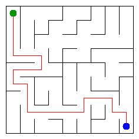

# Assignment 3. Maze Escape

Student ID: 253122
Name: Madi Shalabay
Group: SE-2510
Maze size (rows x columns): 9 x 9

This file is the report. Fill it in as you go. How to start: `START_HERE.md`. The task: `docs/Assignment3.pdf`.

## Program output

The 13 lines your program prints on your data (`java -cp out Main`):

    Broken: 80
    Kept: 64
    Last broken wall: 100
    MST cost: 23025
    Heaviest broken wall: 702
    Path length: 22
    DFS visited: 67
    Dead ends: 24
    Zones: 8
    Largest zone: 17
    Is DAG: 0
    Flow stages: 6
    Fastest route cost: 13

My maze:

## Questions

Answer in your own words, two or three sentences each.

Mission 0. What do find and union do, and what makes them fast in your code?

The find operation determines the representative root of the set containing a given element, while union merges two sets if they are disjoint. They run in nearly O(1) amortized time because path compression flattens the tree during find, and union by size always attaches the smaller tree under the root of the larger one to keep the tree height small.

Mission 1. Why is Broken always R*C - 1, and Kept always (R-1)*(C-1)?

A grid of R rows and C columns contains R*C cells, and any spanning tree connecting all cells without cycles requires exactly R*C - 1 edges (broken walls). Since the total number of inner grid walls is R*(C - 1) + C*(R - 1) = 2*R*C - R - C, subtracting the R*C - 1 broken walls always leaves (2*R*C - R - C) - (R*C - 1) = (R - 1)*(C - 1) walls kept.

Mission 2. My MST cost from Kruskal and from Prim, and why they are equal:

My MST cost is 23025 for both Kruskal and Prim. Both algorithms find a minimum spanning tree on the exact same connected graph, and because all wall costs are unique, the minimum spanning tree is mathematically unique, guaranteeing identical total weights.

Mission 3. Why is there exactly one path between two cells? How did you avoid a stack overflow on a huge maze?

Walls are only broken when they connect previously disconnected sets, which means the resulting maze forms a spanning tree without cycles, and any tree structure has exactly one simple path between any two vertices. To avoid a stack overflow on large 1000x1000 mazes, I implemented an iterative DFS with an explicit array-based stack on the heap instead of using recursion.

Mission 4. Why does the second pass of Kosaraju go on the reversed graph? Why do the slides have no cycle exactly when Zones equals the number of cells?

Reversing the graph keeps the internal connections of strongly connected components intact while reversing the direction of edges between different components, preventing DFS from leaking into other components when started in reverse finish order. If a directed graph has no cycles, no two vertices can reach each other mutually, which forces every single vertex to form its own individual component of size 1.

Mission 5. Why is it enough to go through the zones in the order of their numbers? What does this pass cost?

The second pass of Kosaraju numbers the zones in topological order, so every slide between two distinct zones goes strictly from a smaller zone index to a larger one. Since there are no cycles or backward edges between zones, dynamic programming can compute the longest chain and shortest route in a single linear pass costing O(n + m) time and O(n) auxiliary space.

## AI use

The syllabus requires you to say which AI tools you used and for what. Write the tool (ChatGPT, Copilot, other) and what you asked it: explain an idea, find an error, review code. Write "none" if you did not use any. If you took code or text from a book or a website, give the source here.

ChatGPT: used to review iterative DFS stack handling to prevent stack overflow on large mazes, and to clarify topological condensation ordering in Kosaraju's algorithm.

## Timing (Mission 7)

Milliseconds, 5 runs each, from `java -cp out Bench`.

| maze | Kruskal | Prim |
|---|---|---|
| 100 x 100 | 25 | 17 |
| 300 x 300 | 151 | 117 |
| 1000 x 1000 | 2210 | 2598 |

What do the numbers say about how the time grows? Two or three sentences.

The execution times scale roughly in O(E log E) time as the number of cells increases from 10,000 to 1,000,000. Kruskal is slightly slower than Prim on small mazes due to edge sorting overhead, but performs competitively on the largest 1000x1000 grid because DSU operations are extremely fast.

## Complexity

n is the number of cells, m the number of walls (or slides). Fill in every algorithm you wrote.

| algorithm | time | space | assumptions |
|---|---|---|---|
| DSU find and union | O(alpha(n)) amortized | O(n) | Union by size and path compression are both used |
| Kruskal | O(m log m) | O(n + m) | Sorting m walls dominates DSU operations |
| Prim | O(m log m) | O(n + m) | Binary heap (PriorityQueue) storing up to m edges |
| DFS | O(n) | O(n) | Iterative DFS on a spanning tree where m = n - 1 |
| Kosaraju | O(n + m) | O(n + m) | Two iterative DFS passes over adjacency lists |
| Route in the zone graph | O(n + m) | O(n) | Topological order from Kosaraju pass |

## Before you submit

- data/walls.txt, data/slides.txt and output/maze.png are in the repository.
- `java tools/Check.java` shows all examples right.
- This README is filled in, the program output and the section AI use included.
- The work is pushed to main (at least one commit per mission) and the repository is public.
- The link is attached in Moodle.